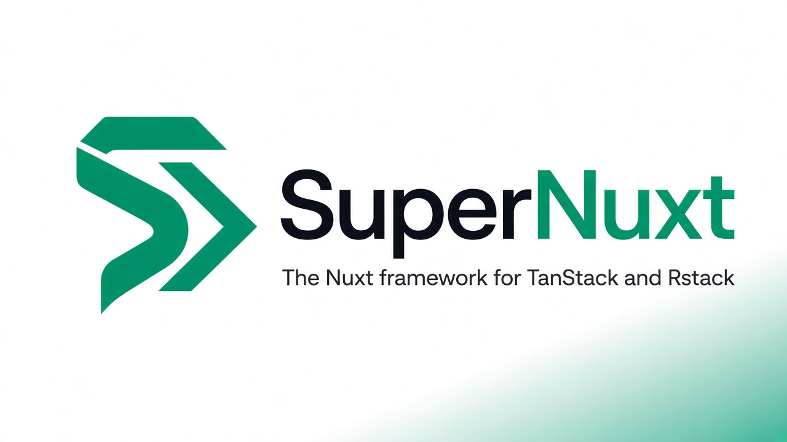

<p align="center">
  <a href="https://github.com/swcstudiospace/SuperNuxt">
    <picture>
      <source media="(prefers-color-scheme: dark)" srcset="./public/brand/banner-dark.jpg">
      
    </picture>
  </a>
</p>

<p align="center">
  <picture>
    <source media="(prefers-color-scheme: dark)" srcset="./public/brand/mark-dark.svg">
    
  </picture>
  <br>
  <picture>
    <source media="(prefers-color-scheme: dark)" srcset="./public/brand/wordmark-dark.svg">
    
  </picture>
</p>

<p align="center">
  <strong>The Nuxt 4 framework for TanStack and Rstack.</strong><br>
  A Nuxt layer and module. Nuxt builds the app. Rstack builds the side console and runs tests, lint, and the core library bundle.
</p>

<p align="center">
  <a href="https://github.com/swcstudiospace/SuperNuxt/actions/workflows/ci.yml"></a>
  <a href="https://www.npmjs.com/package/supernuxt"></a>
  <a href="https://jsr.io/@supernuxt/core"></a>
  <a href="https://nuxt.com"></a>
  <a href="./LICENSE"></a>
</p>

<p align="center">
  <a href="#quick-start">Quick start</a> ·
  <a href="#whats-inside">What's inside</a> ·
  <a href="#documentation">Documentation</a> ·
  <a href="./examples/minimal">Example</a> ·
  <a href="./CONTRIBUTING.md">Contributing</a> ·
  <a href="./SUPPORT.md">Support</a>
</p>

---

> [!NOTE]
> SuperNuxt is **0.2.0** and pre-1.0. `supernuxt` and `create-supernuxt` are not in the npm registry, and `jsr.io/@supernuxt/core` returns 404. Until those publishes exist, use the [from-this-checkout](#from-this-checkout) steps.

## Quick start

These commands are what the scaffolder is written to support after the packages are published:

```bash
npm create supernuxt@latest my-app
cd my-app
npm install
npm run dev
```

<details>
<summary>Other package managers</summary>

```bash
pnpm create supernuxt my-app
bunx create-supernuxt my-app        # use bunx, not `bun create`
npx create-supernuxt@latest my-app
npx supernuxt my-app
deno run -A jsr:@supernuxt/create my-app
```

Scaffolder flags from `packages/create-supernuxt`: `--dir <path>`, `--pm <npm|pnpm|bun|deno>`, `--framework <spec>`, `--force`, `--yes`, `--help`.

</details>

### Add to an existing Nuxt 4 app

As a layer (landing page, `/docs`, `/studio`):

```ts
// nuxt.config.ts
export default defineNuxtConfig({
  extends: ["supernuxt"],
});
```

Or the module only (Vue Query plugin and auto-imports, without those pages):

```ts
export default defineNuxtConfig({
  modules: ["supernuxt"],
  supernuxt: {
    staleTime: 30_000,
    queryDevtools: true,
  },
});
```

`staleTime` and `queryDevtools` are the module defaults in `src/domain/options.ts`.

## What's inside

| Area                 | What this repository contains                                                                                                                                              |
| -------------------- | -------------------------------------------------------------------------------------------------------------------------------------------------------------------------- |
| **Nuxt**             | `nuxt` pinned at `4.6.1`. Direct dependencies include `@nuxt/ui` `^4.11.3`, `tailwindcss` `^4.3.3` (imported from `app/assets/css/main.css`), and `zod` `^4.1.12`.         |
| **Data**             | `@tanstack/vue-query` (one Query client per request), `@tanstack/vue-db`, `@tanstack/vue-store`.                                                                           |
| **Server functions** | `useServerFn(name)` posts to a Zod-checked Nitro handler at `/api/__supernuxt/fn/:name`. `briefing` is the only registered name.                                           |
| **UI primitives**    | TanStack Table, Virtual, Form, Ranger, Charts, Hotkeys, and Pacer, using the Vue packages where this repo depends on them.                                                 |
| **AI**               | `@tanstack/ai` and `@tanstack/ai-vue`. The studio bench calls `useChat` through a local Nitro text adapter and does not need an API key.                                   |
| **Content**          | `@tanstack/markdown` and `@tanstack/highlight`. The in-app docs are markdown files in `content/docs`, rendered by this Nuxt app.                                           |
| **Devtools**         | `@tanstack/vue-devtools` and `@tanstack/vue-query-devtools`, mounted on studio routes when `queryDevtools` is true.                                                        |
| **Dates**            | `dayjs` is a direct dependency. `src/domain/layer.ts` aliases it for the Nuxt build.                                                                                       |
| **Toolchain**        | Rstack (`rstack.config.ts`) runs Rstest, Rslint, Rslib, Rsbuild, and Rsdoctor. Rsbuild writes the side console to `public/rstack-console`. It does not build the Nuxt app. |

### Auto-imports

The module in `modules/supernuxt/index.ts` auto-imports:

`useQuery`, `useMutation`, `useQueryClient`, `useLiveQuery`, `useStore`, `useForm`, `useTable`, `useVirtualizer`, `useHotkey`, `useHotkeys`, `useChat`, `useServerFn`, `useMissionBoard`, `useSuperNuxt`.

### The studio

`/studio` is a page per library. The route table is `studioPages` in `shared/nav.ts`:

Query, DB, Store, Nitro server functions (`/studio/start`), AI, Table, Charts, Form, Ranger, Virtual, Pacer, Hotkeys, Router, prose (Markdown and Highlight), Devtools, and Rstack.

Nuxt owns the document URL. The router bench mounts `@tanstack/vue-router` with `createMemoryHistory` inside the page.

## Documentation

The docs ship inside the app at **`/docs`**, rendered from [`content/docs`](./content/docs):

- [Usage](./content/docs/usage.md)
- [Architecture](./content/docs/architecture.md) (also served at `/docs`)
- [Information](./content/docs/information.md)

There is no second documentation site.

## Example

[`examples/minimal`](./examples/minimal) is the scaffolder output pointed at this checkout (`supernuxt` is `file:../..`).

[](https://stackblitz.com/github/swcstudiospace/SuperNuxt/tree/cursor/docs-brand-hygiene-2706/examples/minimal)

That URL opens `examples/minimal` on this branch. Local run instructions are in the example README. `file:../..` needs the parent package present, which a StackBlitz import of only that folder does not include.

## From this checkout

Node.js **22.21 or newer**. `.nvmrc` pins **22.23.3**. Installed Nuxt packages in this repo declare engines `^22.22.3 || ^24.15.0 || >=26.0.0` (`@nuxt/nitro-server`).

```bash
npm install
npm run dev            # http://127.0.0.1:47821
```

Scaffold an app against this checkout:

```bash
npm run create -- my-app --framework file:.
```

### Scripts

| Script                                        | What it does                                                               |
| --------------------------------------------- | -------------------------------------------------------------------------- |
| `npm run dev`                                 | Nuxt dev server on `127.0.0.1:47821`                                       |
| `npm run build` / `npm run preview`           | Production build / preview on the same host and port                       |
| `npm run typecheck`                           | `nuxt typecheck`                                                           |
| `npm test`                                    | Rstest (`src/**/*.test.ts`)                                                |
| `npm run lint`                                | Rslint                                                                     |
| `npm run format`                              | Rstack formatter                                                           |
| `npm run check`                               | Lint plus format check                                                     |
| `npm run lib`                                 | Bundle `src/index.ts` with Rslib                                           |
| `npm run rstack:dev` / `npm run rstack:build` | Rsbuild side console on port `47831` / write it to `public/rstack-console` |
| `npm run doctor`                              | Rsdoctor report for that Rsbuild console                                   |
| `npm run create -- my-app`                    | Run `packages/create-supernuxt`                                            |

CI (`.github/workflows/ci.yml`) runs test, check, build, and typecheck on Node `22.23.3` and `24.21.0`.

## Packages

| Package             | Registry name                                      | Purpose                                                                                       |
| ------------------- | -------------------------------------------------- | --------------------------------------------------------------------------------------------- |
| `supernuxt`         | npm `supernuxt`                                    | The layer (`nuxt.config.ts`), module (`supernuxt/nuxt`), core (`supernuxt/core`), and CLI bin |
| `create-supernuxt`  | npm `create-supernuxt`                             | `packages/create-supernuxt`, the `npm create supernuxt` scaffolder                            |
| `@supernuxt/core`   | JSR, named in the root `jsr.json`                  | Core and module entry for Deno                                                                |
| `@supernuxt/create` | JSR, named in `packages/create-supernuxt/jsr.json` | Deno scaffolder                                                                               |

Publishing steps for maintainers are in [content/docs/information.md](./content/docs/information.md). The release workflow versions and updates the changelog. It does not publish to npm or JSR.

## Brand

| File                                              | Role                                                                                                                                           |
| ------------------------------------------------- | ---------------------------------------------------------------------------------------------------------------------------------------------- |
| `public/brand/banner.jpg`                         | Light banner (1280×720), white field                                                                                                           |
| `public/brand/banner-dark.jpg`                    | Dark banner at the same size. Recolored from `banner.jpg` for GitHub's dark background. Placeholder until a designer draws a real dark banner. |
| `public/brand/mark.svg`                           | Emerald mark, `#009567`                                                                                                                        |
| `public/brand/mark-dark.svg`                      | Same mark on `#0d1117`                                                                                                                         |
| `public/brand/wordmark.svg` / `wordmark-dark.svg` | "SuperNuxt" lockup for light and dark. The mark geometry is the path from `mark.svg`.                                                          |
| `public/brand/mark.png` / `mark-512.png`          | Raster copies of the mark on an opaque white field                                                                                             |

## Community

- [Contributing guide](./CONTRIBUTING.md)
- [Support](./SUPPORT.md)
- [Code of conduct](./CODE_OF_CONDUCT.md)
- [Security policy](./SECURITY.md)
- [Issues](https://github.com/swcstudiospace/SuperNuxt/issues)
- [Changelog](./CHANGELOG.md)

## License

[MIT](./LICENSE) © 2026 SWC Studio Space
